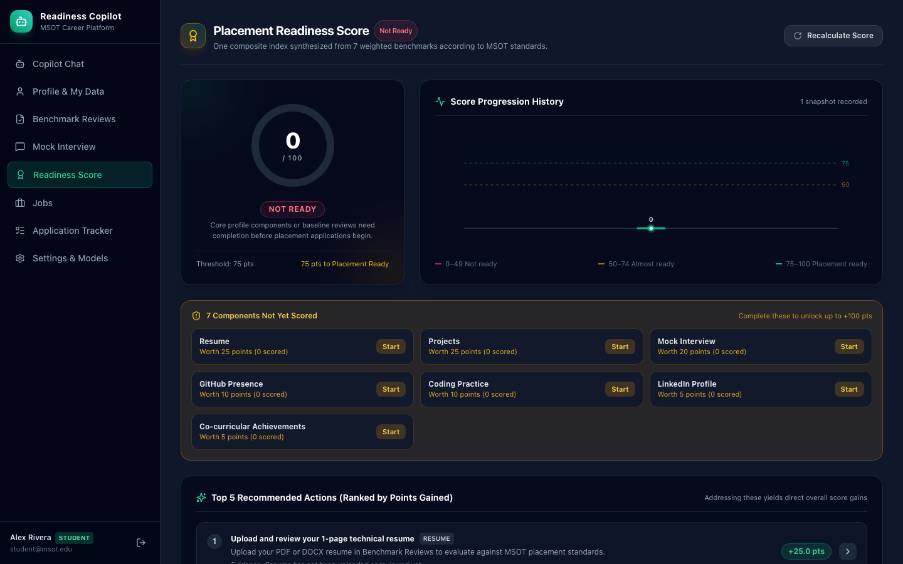
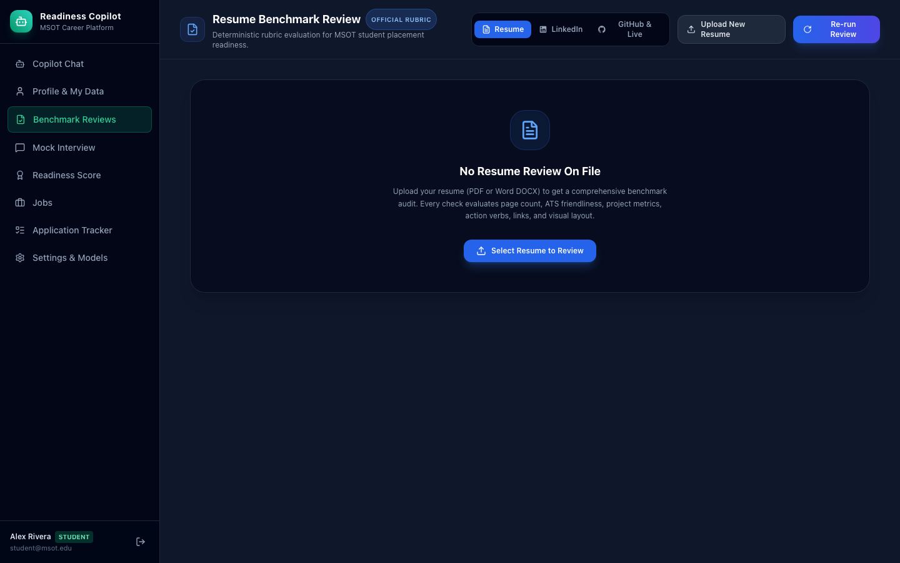
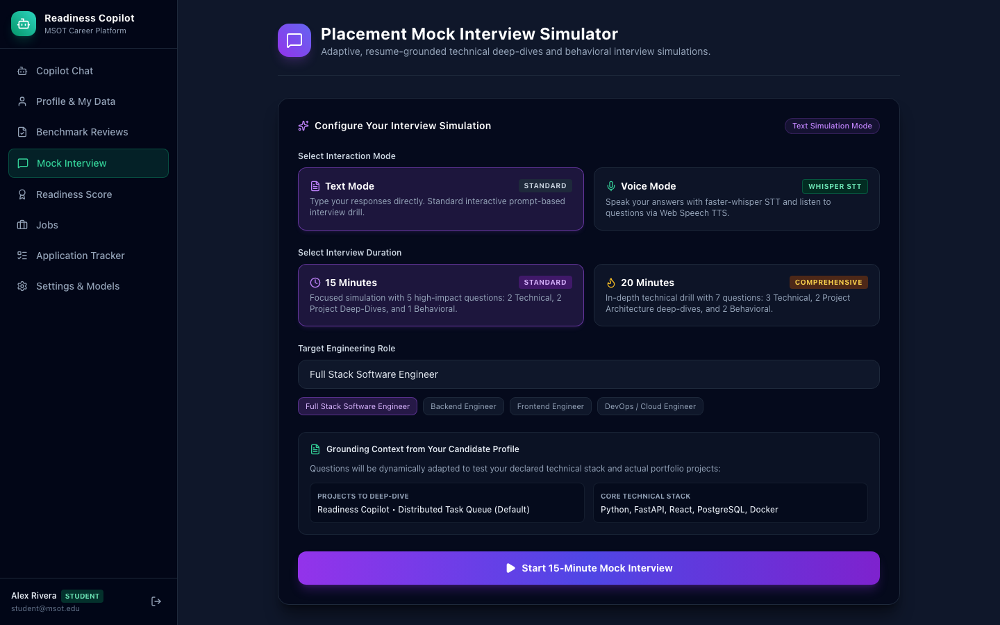
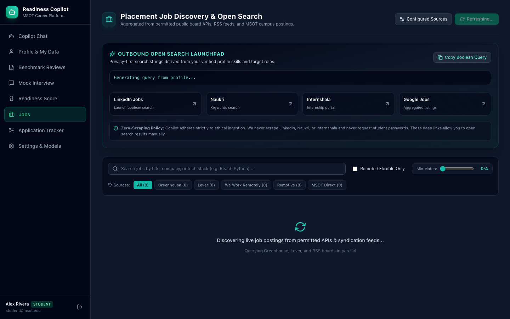
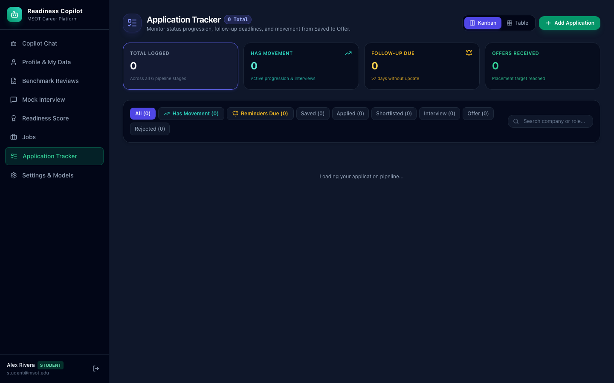
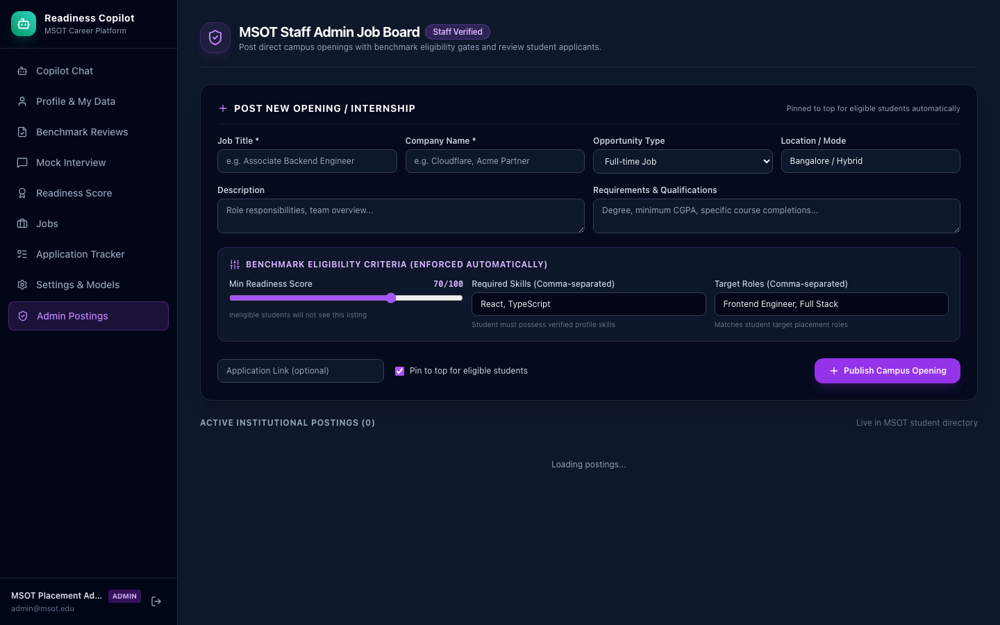

# Placement Readiness Copilot for MSOT Students

A single, unified application with an AI chat interface and career copilot where MSOT students upload their resume, LinkedIn, GitHub, LeetCode, and projects, receive automated benchmark-based reviews, participate in mock interviews (voice & text), calculate an institutional placement readiness score, and discover, apply to, and track jobs. MSOT placement staff can post institutional openings directly to students with automated eligibility gating.

---

## System Architecture

```
├── backend/
│   ├── app/
│   │   ├── llm/               # Unified LLM provider abstraction (Ollama, OpenAI, Claude, Gemini)
│   │   │   ├── adapters/      # Local-first Ollama adapter & cloud adapters
│   │   │   ├── factory.py     # Provider instantiation & failover logic
│   │   │   └── structured.py  # JSON self-correction retry loop (temp=0)
│   │   ├── routers/           # Auth, Profile, Reviews, Interview, Readiness, Jobs, Tracker, Admin, Privacy
│   │   ├── services/          # Parsers, Reviewers, GitHub Auditor, Whisper ASR, Job Discovery, Matcher
│   │   ├── models.py          # SQLAlchemy models (User, Profile, Reviews, Interview, Applications)
│   │   ├── schemas.py         # Pydantic v2 schemas
│   │   ├── auth.py            # PBKDF2 password hashing & JWT role auth
│   │   └── main.py            # FastAPI entrypoint & secure log sanitizer
│   ├── scripts/
│   │   └── seed_data.py       # Seed script (Admin, Demo Student, 5 Diverse Sample Students)
│   ├── data/                  # SQLite DB (WAL mode), uploads, and screenshots
│   └── tests/                 # Module unit & integration tests
├── frontend/                  # React 18 + Vite + Tailwind CSS
│   ├── src/
│   │   ├── components/        # Sidebar, ChatShell, VoiceControls, KanbanBoard
│   │   ├── pages/             # Dashboard, Reviews, Interview, Jobs, Tracker, Admin, Profile, Privacy
│   │   └── api.js             # API client with JWT bearer handling
│   └── package.json
├── tests/                     # Challenge & E2E verification test suite
│   ├── test_consistency.py        # 5-run deterministic score repeatability (±3 pts)
│   ├── test_github_livelinks.py    # Secret scanner & Playwright live deployment verification
│   ├── test_job_matching.py       # Multi-profile ranking & cross-source deduplication
│   ├── test_tracker_msot_e2e.py    # Admin post -> student apply -> candidate triage lifecycle
│   ├── test_privacy_deletion.py   # Consent gating, data wipe, and permanent account deletion
│   ├── locustfile.py              # Locust load test simulating 100 concurrent users
│   └── calculate_token_cost.py    # Real token accounting & API cost per student journey
├── docs/                      # Architecture, benchmarks, module specifications, and test reports
│   └── screenshots/           # High-resolution application UI screenshots
└── Makefile                   # One-command build, launch, test, and seed
```

---

## One-Command Quickstart

### Prerequisites
- **Python**: 3.11 (default in Makefile; `python3.11` required)
- **Node.js**: 18+ and npm
- **Playwright Chromium**: installed automatically during setup via `playwright install chromium` (or manually with `./backend/venv/bin/playwright install chromium`)
- **Ollama** *(optional for local-first offline inference)*: [ollama.com](https://ollama.com/)

### 1. Launch Everything (`make dev`)
```bash
make dev
```
This single command automatically:
1. Bootstraps the Python virtual environment in `backend/venv` with Python 3.11.
2. Installs all backend dependencies (`requirements.txt`).
3. Installs Playwright Chromium headless browser binary (`playwright install chromium`).
4. Installs frontend dependencies (`npm install`).
5. Configures SQLite in Write-Ahead Logging (WAL) mode.
6. Concurrently launches:
   - **FastAPI Backend**: `http://localhost:8000` (Swagger Docs: `http://localhost:8000/docs`)
   - **React Frontend**: `http://localhost:5173`

### 2. Seed Demo Data (`make seed`)
In a separate terminal, populate the database with staff credentials, a demo student, and 5 diverse sample students across all placement readiness tiers:
```bash
make seed
```

### 3. Run Test Suites
- **Fast Offline Tests (`make test`)**:
  Executes fast offline unit and integration tests (under 2 minutes):
  ```bash
  make test
  ```
- **Isolated Browser E2E Tests (`make test-e2e`)**:
  Spawns backend with an isolated temporary database, launches frontend dev server, executes the complete Playwright browser flow (`test_browser_tracker_flow.py`), stops both servers, and wipes the temporary database:
  ```bash
  make test-e2e
  ```
- **Live Ollama Inference Tests (`make test-live`)**:
  Executes live remote Ollama tests against `http://10.134.74.60:11434` (configurable via `OLLAMA_BASE_URL`):
  ```bash
  make test-live
  ```
- **Challenge Verification Suite**:
  ```bash
  ./backend/venv/bin/pytest tests/ -v
  ```

---

## Local-First Offline & Remote Ollama Setup

The Placement Readiness Copilot is engineered from the ground up to run **100% locally with zero paid API keys** using Ollama:

### Option A: Local Ollama on Your Machine
```bash
# 1. Install Ollama (macOS example: brew install ollama)
# 2. Start the local daemon
ollama serve

# 3. Pull recommended models
ollama pull qwen2.5:3b
ollama pull qwen2.5:7b
```

### Option B: Remote Ollama Host (Network GPU / Server)
If Ollama is hosted on a separate server or laptop (e.g. `http://10.134.74.60:11434` or custom URL):
1. In the Copilot UI, open **Settings & Models** (`#nav-settings`).
2. Set **Ollama Base URL** to `http://<server-ip>:11434`.
3. Set **Model** to `qwen2.5:3b` or `qwen2.5:7b`.
4. Click **Save Settings** (or export `OLLAMA_BASE_URL=http://<server-ip>:11434` in your shell).
5. All resume reviews, LinkedIn audits, and placement scores will now execute via Ollama at `$0.00` API cost.

> **Note on Mock Interview**: The voice & text mock interview module is fully built, but intentionally disabled behind `ENABLE_MOCK_INTERVIEW=False` for the submission. The Placement Readiness Score automatically applies the **80% Rescaling Rule** across the active 6 dimensions ($Score / 0.80$).

---

## Demo Credentials

The seed script creates the following pre-configured accounts:

| Role | Email | Password | Details |
| :--- | :--- | :--- | :--- |
| **MSOT Placement Admin** | `admin@msot.edu` | `admin123` | Institutional access, post campus jobs, triage student applicants. |
| **Demo Student** | `student@msot.edu` | `student123` | Alex Rivera (Full Stack, Score: 78 - Placement Ready). |

### 5 Sample Student Profiles (Across Placement Readiness Tiers)

| Student Name | Email | Password | Target Roles | Readiness Score | Placement Tier |
| :--- | :--- | :--- | :--- | :---: | :--- |
| **Ananya Sharma** | `ananya.sharma@msot.edu` | `student123` | Backend, Cloud Infrastructure | **88 / 100** | **Placement ready** |
| **Rohan Patel** | `rohan.patel@msot.edu` | `student123` | Frontend, Full Stack | **78 / 100** | **Placement ready** |
| **Priya Nair** | `priya.nair@msot.edu` | `student123` | Data Science, ML Engineer | **68 / 100** | **Almost ready** |
| **Vikram Verma** | `vikram.verma@msot.edu` | `student123` | DevOps, Site Reliability (SRE) | **58 / 100** | **Almost ready** *(Missing Interview)* |
| **Sneha Reddy** | `sneha.reddy@msot.edu` | `student123` | Software Intern | **38 / 100** | **Not ready** *(Missing Projects & Flaws)* |

---

## Application UI Walkthrough

### 1. Placement Readiness Dashboard
Visualizes the student's real-time readiness score out of 100 across 7 weighted dimensions, deterministic placement tier classification, historical progression SVG chart, and top 5 ranked high-impact action items.



---

### 2. Automated Benchmark Reviewers
Automated rubrics for Resume, LinkedIn, and GitHub public presence. Code-first checks compute page count, contact links, ATS structure, and secret absence, while LLM synthesis operates at `temperature=0` with structured schema validation.



---

### 3. Voice & Text Mock Interview Console
Conducts dynamic, role-tailored technical and behavioral interview sessions with realistic time limits, structured question plans, real-time voice speech-to-text (using local `faster-whisper`), and multi-dimensional rubric scoring.



---

### 4. Permitted Job Discovery Feed
Ingests public job boards from Greenhouse, Lever, RSS feeds, and internal MSOT postings. Deduplicates listings, computes candidate match scores based on verified skills and target roles, and generates 1-click outbound Boolean deep links for LinkedIn, Naukri, and Internshala.



---

### 5. Application Tracker (Kanban & Table)
Full-lifecycle job tracker with interactive Kanban board and tabular views. Tracks application status progression (`Saved` $\to$ `Applied` $\to$ `Interview` $\to$ `Offer` $\to$ `Rejected`), captures interview dates, and records follow-up notes.



---

### 6. MSOT Placement Staff Admin Portal
Institutional portal for placement officers to post verified campus job openings, set eligibility gating (minimum placement readiness score), triage student applicants, and promote candidates across interview stages.



---

## Challenge Verification & Test Results

### 1. Challenge Test Suite (`tests/`)
All challenge verification scripts reside in the root `tests/` directory:

| Test Script | Test Focus | Result |
| :--- | :--- | :---: |
| `tests/test_consistency.py` | 5 consecutive runs on Resume & LinkedIn; verifies delta $\le \pm 3$ pts. | **PASSED** (Delta = 0) |
| `tests/test_github_livelinks.py` | Secret scanner detects AWS/RSA keys; Playwright verifies live deployment HTTP 200 and captures screenshots. | **PASSED** |
| `tests/test_job_matching.py` | Role-specific rankings for Frontend, Backend, and Data Science; cross-source deduplication. | **PASSED** |
| `tests/test_tracker_msot_e2e.py` | Admin post $\to$ student eligibility gating $\to$ application $\to$ interview triage $\to$ stage movement. | **PASSED** |
| `tests/test_privacy_deletion.py` | Explicit consent gate, data wipe, and physical file unlinking on account deletion. | **PASSED** |

Run verification:
```bash
./backend/venv/bin/pytest tests/ -v
```

---

### 2. High-Concurrency Load Test (Locust)
Simulates **125 concurrent student users** interacting with the backend across authentication, profile retrieval, composite readiness score calculation, historical analytics, job discovery feed, and application tracker against a **Mock LLM** (zero traffic sent to Ollama):

```bash
LLM_PROVIDER=mock OFFLINE_MODE=1 backend/venv/bin/uvicorn app.main:app --host 127.0.0.1 --port 8000 --app-dir backend &
backend/venv/bin/locust -f tests/locustfile.py --headless -u 125 -r 25 --run-time 30s --host http://127.0.0.1:8000 --csv=tests/load_test_results
```

#### Measured Load Test Performance:
- **Concurrent Users**: **125 concurrent users** (spawn rate 25/s)
- **Total Requests Handled**: **3,499 requests** in 30 seconds
- **Throughput (RPS)**: **118.03 req/s** sustained (peaked at 125 req/s)
- **Error Rate**: **0.00%** (0 failures across all 3,499 requests)
- **Response Times (Aggregated)**:
  - Median (**p50**): **3 ms**
  - 95th Percentile (**p95**): **18 ms**
  - 99th Percentile (**p99**): **46 ms**
  - Max Response Time: **76 ms**
- **Core Endpoints Breakdown**:
  - `GET /api/readiness/current`: 680 reqs, 0 failures, p50: **2 ms**, p95: **8 ms**
  - `GET /api/jobs/discover`: 568 reqs, 0 failures, p50: **3 ms**, p95: **7 ms**
  - `GET /api/profile/me`: 552 reqs, 0 failures, p50: **2 ms**, p95: **28 ms**
  - `GET /api/health`: 395 reqs, 0 failures, p50: **1 ms**, p95: **8 ms**
  - `GET /api/readiness/history`: 377 reqs, 0 failures, p50: **2 ms**, p95: **9 ms**
  - `GET /api/reviews/{type}/latest`: 373 reqs, 0 failures, p50: **2 ms**, p95: **33 ms**
  - `GET /api/tracker/applications`: 346 reqs, 0 failures, p50: **2 ms**, p95: **27 ms**
  - `POST /api/auth/login`: 208 reqs, 0 failures, p50: **15 ms**, p95: **23 ms**

---

### 3. Empirical Token Accounting & API Cost per Student Journey

Measured with `tests/calculate_token_cost.py` directly from empirical token logs recorded in `backend/data/llm_timing.jsonl` across 151 live model execution runs.

*(All monetary figures below are estimates based on stated API pricing)*:

#### Empirical Token Breakdown:
- **Active Review Journey** (Interview Disabled behind `ENABLE_MOCK_INTERVIEW`):
  - Resume Review (Grammar + Takeaways): 506 prompt / 109 completion
  - LinkedIn Review (Rewrites & Audit): 229 prompt / 76 completion
  - GitHub Code Review (Modularity): 335 prompt / 78 completion
  - Job Match Fit & Explanation: 188 prompt / 90 completion
  - **Subtotal**: **1,258 prompt tokens** / **353 completion tokens** (1,611 tokens total)
- **Full Journey with Mock Interview** (when enabled):
  - 5-turn interactive interview + grading: 3,430 prompt / 1,495 completion
  - **Total**: **4,688 prompt tokens** / **1,848 completion tokens** (6,536 tokens total)

#### Estimated Cost per Student by Provider:
| Provider & Model | Input / 1M | Output / 1M | Active Reviews Cost | Full Journey Cost | Active Students / $1.00 |
| :--- | :---: | :---: | :---: | :---: | :---: |
| **Local Ollama (`qwen2.5:3b/7b`)** | **$0.00** | **$0.00** | **$0.00000** | **$0.00000** | **Unlimited ($0.00)** |
| **Google Gemini 1.5 Flash** *(Rec.)* | $0.075 | $0.30 | **$0.00020** | **$0.00091** | **~5,000 students** |
| **OpenAI gpt-4o-mini** | $0.15 | $0.60 | **$0.00040** | **$0.00181** | **~2,500 students** |
| **Anthropic Claude 3.5 Haiku** | $0.80 | $4.00 | **$0.00242** | **$0.01114** | **~410 students** |
| **OpenAI gpt-4o (Flagship)** | $2.50 | $10.00 | **$0.00668** | **$0.03020** | **~150 students** |

---

## Clean-Clone Verification Procedure

To verify this project from scratch:
```bash
# 1. Clone repository into a fresh workspace
git clone <repo-url> fresh-copilot
cd fresh-copilot

# 2. Boot dependencies and launch application
make dev

# 3. In a separate terminal, seed demo data
make seed

# 4. Run full test suite
make test
```
All dependencies, virtual environments, SQLite database schemas, and Node modules configure automatically with zero manual file editing.
