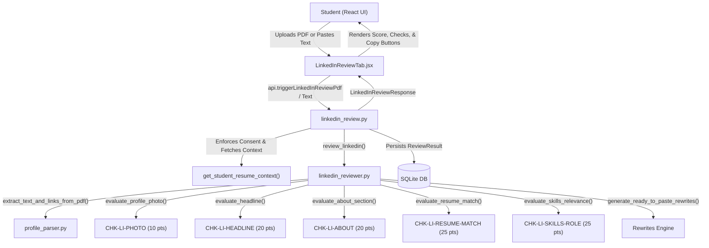

# Module 04: LinkedIn Benchmark Review

## 1. What the Module Does
Module 04 implements the **Placement Readiness LinkedIn Reviewer** for MSOT students:
- **Canonical 5-Point Rubric**: Evaluates student LinkedIn profiles strictly against the placement readiness benchmark specified in [docs/benchmarks.md](../benchmarks.md):
  1. Professional profile photo present (`CHK-LI-PHOTO`, 10 pts)
  2. Headline present, specific, and within LinkedIn's 220-character limit (`CHK-LI-HEADLINE`, 20 pts)
  3. About section present and substantive with >= 150 characters and >= 30 words (`CHK-LI-ABOUT`, 20 pts)
  4. Work experience and projects align with the student's verified resume (`CHK-LI-RESUME-MATCH`, 25 pts)
  5. Skills listed and relevant to declared placement target role (`CHK-LI-SKILLS-ROLE`, 25 pts)
- **Deterministic-First Computation**: Evaluates checks directly in code (photo detection, headline length and generic pattern analysis, About length, cross-reference role comparison, and role taxonomy skill matching).
- **Zero-Hallucination Ready-to-Paste Rewrites**: Generates tailored headline ($\le 220$ characters) and About summary rewrites derived 100% from verified candidate profile and resume facts, with zero invented degrees, companies, or titles.
- **Specific Actionable Fixes**: Flags exact discrepancies (e.g. *"Mismatch detected: LinkedIn lists 'VP of Engineering at Acme Cloud Solutions' whereas Resume lists 'Software Engineering Intern at Acme Cloud Solutions'"*) with clear fixes.
- **Dual Input Support**: Accepts both official LinkedIn "Save to PDF" exports and pasted plain profile text.
- **Interactive UI with Copy-to-Clipboard**: Renders readiness score gauge, tier badge, checklist cards with evidence & specific fixes, and ready-to-paste rewrites with one-click **"Copy Headline"** and **"Copy About"** buttons featuring animated confirmation feedback.

---

## 2. How It Works (Flow with Exact Files and Functions)



### A. Review Trigger Flow
1. **Student Request**:
   - The student navigates to the **Benchmark Reviews** tab, clicks the **LinkedIn** sub-tab in [ResumeReviewPage.jsx](../../frontend/src/pages/ResumeReviewPage.jsx), and chooses either **Upload PDF Export** or **Paste Profile Text** in [LinkedInReviewTab.jsx](../../frontend/src/pages/LinkedInReviewTab.jsx).
   - Calling `api.triggerLinkedInReviewPdf(file)` sends a multipart form request to `POST /api/reviews/linkedin`.
   - Calling `api.triggerLinkedInReviewText(text)` sends JSON `{ text }` to `POST /api/reviews/linkedin/paste`.
2. **Consent & Verification Context**:
   - In [linkedin_review.py](../../backend/app/routers/linkedin_review.py), endpoints verify that `profile.consent_given == True`.
   - `get_student_resume_context()` retrieves the candidate's verified resume data from `profile.parsed_resume` or parses their latest stored resume file.

### B. Benchmark Evaluation Engine
In [linkedin_reviewer.py](../../backend/app/services/linkedin_reviewer.py), `review_linkedin` executes all 5 checks:
1. `evaluate_profile_photo(doc, raw_text, source)`:
   - For PDF export, `detect_pdf_profile_photo` inspects embedded image objects on page 1 within the top 40% header region with avatar dimensions and aspect ratio.
   - For pasted text, scans for profile photo presence indicators.
2. `evaluate_headline(headline, target_role)`:
   - Validates length is $\le 220$ characters.
   - Rejects empty, generic patterns (e.g. `^student\b`, `^aspiring\b`, `^looking for\b`), and ensures recognized role or skill keywords exist.
3. `evaluate_about_section(about, target_role)`:
   - Verifies length $\ge 150$ characters and $\ge 30$ words.
   - Flags brief 1-sentence summaries and requires substantive background and technical focus.
4. `evaluate_resume_match(parsed_data, resume_context)`:
   - Cross-references LinkedIn experiences and project titles against verified resume items.
   - Detects direct title and seniority contradictions (e.g. "VP of Engineering" vs "Software Engineering Intern"), unverified senior claims, and omissions.
   - Flags the exact conflicting item in both `evidence` and `fix`.
5. `evaluate_skills_relevance(skills, target_roles)`:
   - Matches candidate's extracted skills against curated role taxonomies (`ROLE_TAXONOMIES` for Full Stack, Backend, Frontend, Data/ML).
   - Requires $\ge 5$ verified technical skills.
6. `generate_ready_to_paste_rewrites(linkedin_data, resume_context, target_role, adapter)`:
   - Constructs `headline` rewrite guaranteed $\le 220$ characters using target role and top verified skills.
   - Constructs 2-paragraph `about` rewrite summarizing actual technical stack, verified projects, and career focus.
   - Strict adherence to ground truth: zero hallucinated companies or degrees.

### C. Database Persistence & UI Flow
1. **Persistence**:
   - Saves record to SQLite table `review_results` with `review_type = "linkedin"`, `score`, `summary`, `checks`, and `rewrites`.
2. **UI Presentation**:
   - [LinkedInReviewTab.jsx](../../frontend/src/pages/LinkedInReviewTab.jsx) displays the 0–100 score gauge, tier badge, breakdown cards, and "Ready-to-Paste Profile Rewrites" with clipboard copy functionality.

---

## 3. Key Design Decisions & Alternatives Rejected

1. **Dual Input (PDF Export & Pasted Text)**:
   - *Decision*: Support both official LinkedIn "Save to PDF" exports and copy-pasted plain text.
   - *Alternative Rejected*: Requiring students to only upload PDFs (inconvenient for quick iterations) or only paste text (loses layout and photo stream metadata).
2. **Unified Navigation under Benchmark Reviews**:
   - *Decision*: Placed LinkedIn Review as a tab alongside Resume Review inside the main "Benchmark Reviews" sidebar section.
   - *Alternative Rejected*: Adding a separate top-level sidebar tab for LinkedIn Review. Keeping both reviews under "Benchmark Reviews" consolidates candidate evaluation in one unified assessment hub.
3. **Deterministic Scoring First**:
   - *Decision*: Compute photo presence, headline bounds, About length, resume entity match, and skill taxonomies in deterministic code.
   - *Alternative Rejected*: Relying entirely on unconstrained LLM prompts for scoring. Unconstrained LLMs exhibit non-deterministic drift and violate the $\pm 3$ score consistency rule.
4. **Guaranteed Non-Hallucinatory Rewrites**:
   - *Decision*: Synthesize headline and About rewrites strictly by interpolating verified candidate skills, project names, and companies extracted from their resume and profile.
   - *Alternative Rejected*: Free-form LLM generation without context constraints, which frequently hallucinates prestigious companies (e.g., claiming the candidate worked at Google or graduated from Stanford).

---

## 4. Shortcuts or Faked Parts

- **Zero Mocking of Business Logic**: All benchmark checks, PDF image stream extractions, text parsing, entity cross-referencing, and rewrite generators are 100% real code executed live.
- **Local Browser Testing**: Browser automation executed real end-to-end clicks, form submission, and clipboard copy operations.

---

## 5. Verify It Yourself

To verify the LinkedIn review module independently, run the following steps:

### Step 1: Run Automated Backend Tests
```bash
backend/venv/bin/pytest -v -s backend/tests/test_linkedin_review.py
```
- **Expected Result**: All 6 tests pass in $< 1$s. Strong profile scores 100, contradictory profile flags the mismatch with *"VP of Engineering at Acme Cloud Solutions"*, and 5x consistency test reports variance $= 0 \le 3$.

### Step 2: Verify API Endpoints via curl
Start the backend (`make dev` or `backend/venv/bin/uvicorn app.main:app --port 8000 --app-dir backend`) and run:
```bash
# Register test student
TOKEN=$(curl -s -X POST http://localhost:8000/api/auth/register \
  -H "Content-Type: application/json" \
  -d '{"email":"curl_student@example.com","password":"password123","role":"student"}' | jq -r '.access_token // empty')

if [ -z "$TOKEN" ]; then
  TOKEN=$(curl -s -X POST http://localhost:8000/api/auth/login \
    -H "Content-Type: application/json" \
    -d '{"email":"curl_student@example.com","password":"password123"}' | jq -r .access_token)
fi

# Grant consent
curl -s -X POST http://localhost:8000/api/profile/consent \
  -H "Authorization: Bearer $TOKEN" \
  -H "Content-Type: application/json" \
  -d '{"consent_given": true}'

# Trigger LinkedIn review with pasted text
curl -s -X POST http://localhost:8000/api/reviews/linkedin/paste \
  -H "Authorization: Bearer $TOKEN" \
  -H "Content-Type: application/json" \
  -d '{"text":"Alex Rivera\nFull Stack Developer | Python, React, FastAPI\n[Profile Photo: Yes]\n\nAbout\nI am a Full Stack Developer with experience in web applications and backend architecture. Proficient in Python, React, PostgreSQL, Docker, and REST APIs. Passionate about building reliable software.\n\nExperience\nSoftware Engineering Intern at Acme Cloud Solutions\n\nSkills\nPython, React, TypeScript, FastAPI, PostgreSQL, Docker, Git"}' | jq '{score: .score, summary: .summary, rewrites: .rewrites}'
```
- **Expected Result**: Returns JSON with `score >= 85`, `rewrites.headline` ($\le 220$ chars), and non-empty `rewrites.about`.

### Step 3: Interactive UI Verification in Browser
1. Open `http://localhost:5173/` in your browser.
2. Log in or register as a student. Ensure consent is enabled in **Profile & My Data**.
3. Click **Benchmark Reviews** in the sidebar, then click the **LinkedIn** tab.
4. Select **Paste Profile Text**, paste your profile text, and click **Run LinkedIn Benchmark Review**.
5. Observe the score gauge, tier badge, and 5 checklist cards.
6. Click **Copy Headline** and **Copy About**; confirm each button momentarily updates to a green **"Copied!"** checkmark.

---

## Changes

### 2026-10-16: Module 06 Readiness Score Trigger Integration
- Integrated `compute_and_save_readiness_score` into `POST /api/reviews/linkedin` in `backend/app/routers/linkedin_review.py`.
- Whenever a student submits or re-runs a LinkedIn review, the overall placement readiness score automatically recalculates and records a timestamped snapshot in `models.ReadinessScoreSnapshot`.
