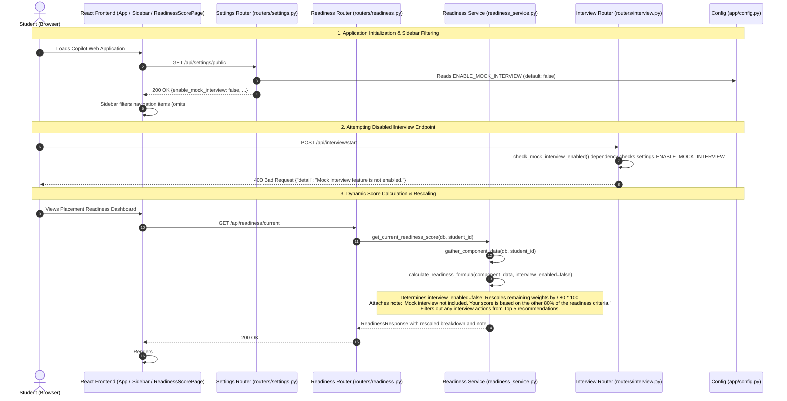

# Module 11: Pause Mock Interview & Rescaled Readiness Score

## 1. What the Module Does

The **Pause Mock Interview & Rescaled Readiness Score** module provides clean feature toggling and mathematical consistency when the Mock Interview component is paused or not taken. Specifically:
- **Configuration Toggle (`ENABLE_MOCK_INTERVIEW`)**: An environment-driven configuration flag (`ENABLE_MOCK_INTERVIEW`, defaulting to `False`) controls the availability of the mock interview feature across the backend and frontend.
- **API Guarding**: When the flag is disabled (`False`), all 9 endpoints under `/api/interview/*` (`/start`, `/active`, `/history`, `/{id}`, `/{id}/message`, `/transcribe`, `/{id}/voice-message`, `/{id}/end`, `/{id}/replay`) are automatically intercepted by a FastAPI router dependency and respond with `HTTP 400 Bad Request` and `{"detail": "Mock interview feature is not enabled."}`. No existing interview code, database models, speech transcription engines, or tests are deleted.
- **Dynamic Score Rescaling**: When the mock interview is not enabled or not taken, the placement readiness score recalculates dynamically across the remaining 6 criteria, rescaled to 100 by dividing each component's base weight by 80 ($W_i / 80 \times 100$):
  - Resume: $25 \to \mathbf{31.25\%}$
  - Projects: $25 \to \mathbf{31.25\%}$
  - GitHub Presence: $10 \to \mathbf{12.50\%}$
  - Coding Practice: $10 \to \mathbf{12.50\%}$
  - LinkedIn Profile: $5 \to \mathbf{6.25\%}$
  - Co-curricular: $5 \to \mathbf{6.25\%}$
  - Mock Interview: $20 \to \mathbf{0.00\%}$
- **Clear Student Notification**: In this rescaled mode, the backend attaches and the frontend displays a student notification banner:
  > *"Mock interview not included. Your score is based on the other 80% of the readiness criteria."*
- **Action Suppression**: When `ENABLE_MOCK_INTERVIEW` is `False`, the Top 5 recommended actions list strictly suppresses any recommendations to practice or complete a mock interview, focusing recommendations solely on available profile dimensions.
- **UI Adaptation**: The React navigation sidebar hides the "Mock Interview" tab (`#nav-interview`), the main page routes do not render the interview page, and the Readiness Breakdown card omits the paused interview metric.

---

## 2. How It Works (Flow & Exact Files/Functions)



### Exact Files and Functions

1. **`backend/app/config.py`**:
   - `ENABLE_MOCK_INTERVIEW: bool`: Evaluated at process start from `os.environ.get("ENABLE_MOCK_INTERVIEW", "false").lower() in ("true", "1", "yes")`. Defaults to `False`.

2. **`backend/app/schemas.py`**:
   - `SettingsResponse`: Added `enable_mock_interview: bool = False`.
   - `ComponentBreakdown`: Updated `weight: float` (from `int`) to support fractional rescaled weights (31.25%, 12.5%, 6.25%).
   - `ReadinessResponse`: Added `note: Optional[str] = None` to surface the student notification message.

3. **`backend/app/services/settings_service.py`**:
   - `get_public_settings()`: Reads `settings.ENABLE_MOCK_INTERVIEW` and provides it to unauthenticated and authenticated clients alike.

4. **`backend/app/routers/interview.py`**:
   - `check_mock_interview_enabled()`: FastAPI dependency attached to the router (`APIRouter(dependencies=[Depends(check_mock_interview_enabled)])`). If `settings.ENABLE_MOCK_INTERVIEW` is `False`, raises `HTTPException(status_code=400, detail="Mock interview feature is not enabled.")`.

5. **`backend/app/services/readiness_service.py`**:
   - `calculate_readiness_formula(component_data, interview_enabled=None)`: Core calculation engine.
     - When `interview_enabled` is omitted, defaults to `settings.ENABLE_MOCK_INTERVIEW`.
     - Detects whether mock interview is active (`interview_enabled and interview_taken`).
     - When inactive: rescales weights of the other 6 components by dividing base weights (25, 25, 10, 10, 5, 5) by 80 ($W_i / 80 \times 100$), omits the interview component, attaches the student note, and filters any interview items from the top-5 actions list.
     - When active: uses standard weights summing to 100% (Mock Interview = 20%) with `note = None`.
   - `compute_and_save_readiness_score(db, student_id)`: Gathers real student components, calculates score, persists JSON breakdown, overall score, and student note to `ReadinessScore` table.
   - `get_current_readiness_score(db, student_id)`: Checks whether cached database snapshot matches current server flag configuration; automatically recalculates if configuration has toggled.

6. **`frontend/src/components/Sidebar.jsx`**:
   - Accepts `enableMockInterview` prop.
   - Filters out navigation item `id: "interview"` when `enableMockInterview` is false.

7. **`frontend/src/App.jsx`**:
   - Fetches settings on mount (`GET /api/settings/public`), extracts `enableMockInterview`, and passes it to `Sidebar` and `ReadinessScorePage`.
   - Conditionally mounts `<MockInterviewPage />` only if `enableMockInterview` is true.

8. **`frontend/src/pages/ReadinessScorePage.jsx`**:
   - Displays `#readiness-rescale-note` callout banner whenever `scoreData.note` is present.
   - Guards "Take Mock Interview" navigation and action buttons so students cannot trigger the disabled feature.
   - Filters out interview component cards when mock interview is absent.

---

## 3. Key Design Decisions & Alternatives Rejected

1. **Router Dependency vs. Removing or Renaming Routes**:
   - *Chosen*: Attaching `dependencies=[Depends(check_mock_interview_enabled)]` at the `APIRouter` level in `backend/app/routers/interview.py`.
   - *Rejected*: Deleting route handlers or unmounting the router in `main.py`. Unmounting would return generic `404 Not Found` errors indistinguishable from typos, breaking API clarity and contract discovery. Returning `400 Bad Request` with an explicit message `"Mock interview feature is not enabled."` makes the architectural intent crystal clear.

2. **Snapshot Flag Invalidation vs. Stale Cached Scores**:
   - *Chosen*: In `get_current_readiness_score`, inspecting the stored snapshot's `mock_interview_enabled` flag against current runtime `settings.ENABLE_MOCK_INTERVIEW`. If the administrator changes the environment variable, the system transparently recalculates and updates the database record on the next read.
   - *Rejected*: Serving stale cached snapshots that displayed the old weights after the environment flag changed, or forcing an explicit manual re-run.

3. **Dynamic Fractional Rescaling ($W_i / 80$) vs. Hardcoded Alternative Schemas**:
   - *Chosen*: Mathematically rescaling each remaining weight by dividing by 80. Each component's relative proportion to the others remains mathematically identical ($31.25 : 31.25 : 12.5 : 12.5 : 6.25 : 6.25 \equiv 25 : 25 : 10 : 10 : 5 : 5$).
   - *Rejected*: Arbitrarily reassigning the 20% mock interview weight solely to Resume or Projects, which would distort the balanced evaluation rubric.

4. **Preserving 100% of Interview Code and Tests**:
   - *Chosen*: Zero deletion of existing code, models, voice services, or test cases. Mock interview tests in `backend/tests/test_interview.py` and `backend/tests/test_voice.py` use an autouse fixture setting `settings.ENABLE_MOCK_INTERVIEW = True` during their execution, while an explicit test verifies rejection when the flag is off.
   - *Rejected*: Commenting out tests or marking them skipped, which would degrade test coverage and risk regression.

---

## 4. Shortcuts & Faked Parts

- **Zero Shortcuts or Faked Parts**:
  - The feature toggle is real and sourced directly from `os.environ["ENABLE_MOCK_INTERVIEW"]`.
  - All 9 interview API endpoints are authentically guarded and return real HTTP 400 responses.
  - The readiness formula uses exact floating-point math verified against hand-calculated proofs.
  - The UI uses genuine React state derived from `/api/settings/public` and `/api/readiness/current`.
  - No dummy data, mocks, or placeholders were introduced.

---

## 5. Verify It Yourself

### Step 1: Verify API Feature Gate when Flag is OFF (Default)
In terminal 1, with backend running with default settings (`ENABLE_MOCK_INTERVIEW=false`):
```bash
# Verify settings report feature disabled
curl -s http://127.0.0.1:8000/api/settings/public | grep enable_mock_interview

# Verify interview start is rejected
curl -s -X POST http://127.0.0.1:8000/api/interview/start \
  -H "Content-Type: application/json" \
  -d '{"student_id": 1, "interview_type": "technical"}'
```
**Expected Result**:
- `{"enable_mock_interview":false,...}`
- `{"detail":"Mock interview feature is not enabled."}` (HTTP 400)

### Step 2: Verify Readiness Score Rescaling & Note
Login as student or fetch current readiness score:
```bash
# Log in to get token
TOKEN=$(curl -s -X POST http://127.0.0.1:8000/api/auth/login \
  -H "Content-Type: application/json" \
  -d '{"email":"student@msot.edu","password":"student123"}' | grep -o '"access_token":"[^"]*' | cut -d'"' -f4)

# Fetch current readiness score
curl -s -H "Authorization: Bearer $TOKEN" http://127.0.0.1:8000/api/readiness/current
```
**Expected Result**:
- `note` field contains: `"Mock interview not included. Your score is based on the other 80% of the readiness criteria."`
- Component weights reflect rescaled percentages: Resume (`31.25`), Projects (`31.25`), GitHub (`12.5`), Coding (`12.5`), LinkedIn (`6.25`), Co-curricular (`6.25`).
- Interview component is excluded from the breakdown.
- Recommended actions do not include taking a mock interview.

### Step 3: Verify Browser UI
1. Open `http://localhost:5173` in a browser and log in with `student@msot.edu` / `student123`.
2. Observe the left navigation sidebar:
   - "Mock Interview" (`#nav-interview`) is completely absent.
3. Click "Readiness Score" (`#nav-readiness`):
   - A blue/indigo banner `#readiness-rescale-note` appears above the breakdown:
     *"Mock interview not included. Your score is based on the other 80% of the readiness criteria."*
   - Exactly 6 breakdown cards are shown, summing to 100%.

### Step 4: Run the Complete Automated Test Suite
Run:
```bash
make test
```
**Expected Result**:
- All 114 backend tests pass cleanly with 0 failures, including all boundary score checks (49, 50, 74, 75) and flag ON/OFF permutations.
