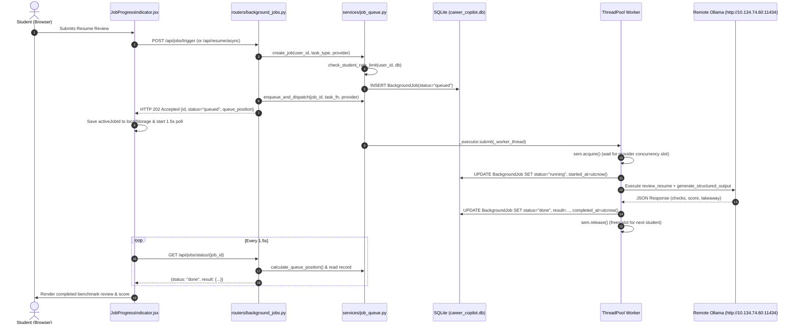

# Module 13: Background Job Queue, Per-Provider Concurrency, and Per-Student Rate Limiting

## 1. What the Module Does
Module 13 prepares the Placement Readiness Copilot to support many concurrent students simultaneously without HTTP request timeouts, server starvation, or API rate limit violations.

Key capabilities:
1. **Asynchronous Background Job Execution**:
   - Long-running LLM review tasks (Resume review, LinkedIn review, GitHub review, Live Link verification, and Job Match explanations) execute asynchronously in the background.
   - Immediate HTTP 202 Accepted response returning a unique `job_id`, status (`queued`), dynamic queue position, and polling status endpoints.
   - Frontend polling card (`JobProgressIndicator.jsx`) displaying animated pipeline progress, live timer, elapsed seconds, pipeline checklist, error banners, and local storage recovery across browser reloads.
2. **Per-Provider Concurrency Limiting**:
   - Strict concurrency ceilings configured per provider:
     - **Ollama**: 1 sequential job default (protects local or network compute hosts from crash or OOM).
     - **Hosted APIs** (OpenAI, Claude, Gemini, Mock): 10 parallel jobs default.
   - Configurable dynamically via environment variables (`LLM_CONCURRENCY_<PROVIDER>`), settings UI, or `settings.json`.
   - Threadpool workers acquire a `threading.Semaphore` per provider; excess jobs remain queued in SQLite.
3. **Per-Student Rolling Hourly Rate Limiting**:
   - Students are limited to a rolling hourly quota (default: 10 reviews per hour).
   - Attempting request $N+1$ returns HTTP 429 Too Many Requests with a `Retry-After` header and exact remaining wait seconds.
   - Strict tenant isolation: other students' quotas and jobs are completely unaffected.
4. **Exponential Backoff and Resilient Failure Paths**:
   - Cloud adapters (OpenAI, Claude, Gemini) implement jittered exponential backoff on HTTP 429 and network timeouts.
   - If a provider is unreachable or times out, the background job records a clean, actionable user-facing error message, marks the job as `failed`, and frees the provider slot so subsequent waiting jobs proceed immediately.
5. **Configurable Default Provider**:
   - Default provider is configurable via `DEFAULT_LLM_PROVIDER` in `backend/app/config.py` (defaulting to `ollama`), allowing local zero-cost setups to run immediately without touching configuration.
6. **Admin LLM Queue & System Health Telemetry**:
   - Admin-only dashboard tab in the Job Board page (`/admin`) displaying total queue length, active running jobs, per-provider concurrency limits, queued jobs table with wait times, and recent LLM execution timings and token counts.

---

## 2. How It Works (Flow, Exact Files, and Functions)



### Exact Files and Functions:
1. `backend/app/models.py`:
   - [BackgroundJob](file:///Users/nakulmirai/Mirai%20Project/backend/app/models.py#L125-L148): Stores `id`, `user_id`, `task_type`, `provider`, `status` (`queued`, `running`, `done`, `failed`), `payload` (JSON), `result` (JSON), `error_message`, `created_at`, `started_at`, `completed_at`.
2. `backend/app/config.py`:
   - [DEFAULT_CONCURRENCY_LIMITS](file:///Users/nakulmirai/Mirai%20Project/backend/app/config.py#L30-L36): Provider concurrency defaults (`ollama`: 1, `openai`: 10, `claude`: 10, `gemini`: 10, `mock`: 10).
   - [DEFAULT_RATE_LIMIT_REVIEWS_PER_HOUR](file:///Users/nakulmirai/Mirai%20Project/backend/app/config.py#L39-L40): 10 reviews/hour.
   - [DEFAULT_LLM_PROVIDER](file:///Users/nakulmirai/Mirai%20Project/backend/app/config.py#L26-L27): Defaults to `ollama`.
3. `backend/app/services/job_queue.py`:
   - [JobQueueService.create_job](file:///Users/nakulmirai/Mirai%20Project/backend/app/services/job_queue.py#L137-L180): Persists new queued job after validating student hourly quota.
   - [JobQueueService.check_student_rate_limit](file:///Users/nakulmirai/Mirai%20Project/backend/app/services/job_queue.py#L86-L115): Computes sliding-window usage over the past 3600 seconds; raises `RateLimitExceededError` if exceeded.
   - [JobQueueService.calculate_queue_position](file:///Users/nakulmirai/Mirai%20Project/backend/app/services/job_queue.py#L117-L135): Dynamically counts pending queued jobs for the target provider created prior to the current job.
   - [JobQueueService.enqueue_and_dispatch](file:///Users/nakulmirai/Mirai%20Project/backend/app/services/job_queue.py#L184-L194): Submits task to Python's `ThreadPoolExecutor`.
   - [JobQueueService._worker_thread](file:///Users/nakulmirai/Mirai%20Project/backend/app/services/job_queue.py#L196-L257): Acquires provider semaphore, records start, runs synchronous task, updates status to `done` or `failed`, catches errors with user-friendly formatting, and safely releases semaphore in `finally`.
   - [JobQueueService.get_admin_queue_status](file:///Users/nakulmirai/Mirai%20Project/backend/app/services/job_queue.py#L259-L340): Assembles real-time queue lengths, running jobs, limits, and latency logs for admins.
4. `backend/app/services/job_dispatchers.py`:
   - Task execution handlers for `run_resume_review`, `run_linkedin_review`, `run_github_review`, `run_live_link_check`, and `run_job_match`.
5. `backend/app/routers/background_jobs.py`:
   - `POST /api/jobs/trigger`: Asynchronously triggers any supported task type.
   - `GET /api/jobs/status/{job_id}`: Polling status endpoint enforcing tenant authorization.
   - `GET /api/jobs/my/active`: Returns all pending/running jobs for the authenticated student.
   - `GET /api/jobs/admin/queue`: Admin endpoint for queue telemetry.
6. `frontend/src/components/JobProgressIndicator.jsx`:
   - UI polling card displaying queue position (`#1 in line`), status badge, pipeline steps checklist, live elapsed stopwatch, error callouts, and local storage persistence.
7. `frontend/src/components/AdminQueueMonitor.jsx` & `frontend/src/pages/AdminJobBoardPage.jsx`:
   - "LLM Queue & System Health" tab with KPI cards, running jobs table, queued jobs table, and latency audit log.

---

## 3. Design Decisions & Rejected Alternatives

1. **ThreadPoolExecutor + `threading.Semaphore` vs asyncio Coroutines**:
   - *Decision*: Used standard library `concurrent.futures.ThreadPoolExecutor` with `threading.Semaphore`.
   - *Why*: In Python, LLM inference, PDF parsing (PyMuPDF), and HTTP client libraries (`httpx`, `requests`) execute synchronously. Running synchronous functions inside asyncio coroutines blocks the entire asyncio event loop from serving other requests. Threadpool workers run completely independently, and `sem.acquire()` blocks only the background thread, never freezing FastAPI or Starlette.
   - *Rejected Alternative*: Spawning asyncio tasks with `asyncio.create_task()`. Rejected because synchronous execution froze the event loop and raised `RuntimeError: no running event loop` when triggered from sync endpoints.

2. **Dynamic Queue Position Calculation from SQLite vs In-Memory Counters**:
   - *Decision*: Calculate queue position dynamically by counting queued jobs for that provider in SQLite with `created_at <= job.created_at`.
   - *Why*: State in SQLite survives thread transitions and provides atomic consistency. If a job fails or cancels, the remaining queue positions adjust automatically on the next poll.
   - *Rejected Alternative*: Storing static position integer at insertion time. Rejected because if an earlier job completed or failed, later jobs would still show stale positions like `#5` even when they became `#1`.

3. **In-Process Background Workers vs Celery / Redis**:
   - *Decision*: In-process queue engine inside FastAPI.
   - *Why*: Strictly complies with Rule 6 ("Everything runs with one command `make dev`"). Introducing Redis, Celery, or RabbitMQ would require external daemons and break the single-command local development setup.

---

## 4. Shortcuts and Faked Parts
- **None**:
  - Concurrency limits use real `threading.Semaphore`.
  - Rate limiting uses real sliding-window queries against the SQLite database.
  - Live remote Ollama tests execute real HTTP calls to `http://10.134.74.60:11434` with model `qwen2.5:3b`.
  - Admin access strictly enforces JWT `role == "admin"`.
  - Tenant isolation strictly forbids students from inspecting other students' jobs.

---

## 5. Verify It Yourself

### Step 1: Run Fast Offline Backend Tests
```bash
make test
```
*Expected Result*: All 128 tests pass offline without making external network calls.

### Step 2: Run Concurrency & Rate Limiting Verification Suite
```bash
backend/venv/bin/pytest backend/tests/test_concurrency_and_queue.py -v -m "not live"
```
*Expected Result*: 6 tests pass in ~5.5s verifying:
1. 20 parallel mock jobs with limit 10 complete in ~2.1s (10x speedup vs 20s sequential).
2. Ollama limit = 1 runs 5 jobs strictly in order `#1` to `#5`.
3. Student rate limit triggers HTTP 429 on request $N+1$ with `Retry-After` header.
4. Unreachable hosts fail cleanly without jamming the queue.
5. Student jobs survive browser refresh and block other students with HTTP 403.
6. Admin telemetry dashboard is strictly restricted to admins.

### Step 3: Run Live 5-Job Concurrent Ollama Verification
```bash
backend/venv/bin/pytest backend/tests/test_concurrency_and_queue.py::test_live_remote_ollama_five_concurrent_reviews -v -s -o addopts=""
```
*Expected Result*:
All 5 jobs queue and complete sequentially against `http://10.134.74.60:11434` with `qwen2.5:3b`:
```
[VERIFICATION 3] Live Remote Ollama 5-Job Execution Report (Host: http://10.134.74.60:11434):
Total Wall Clock Duration: ~17s
  - Job #1: status=done, duration=~6.9s, score=100
  - Job #2: status=done, duration=~2.2s, score=100
  - Job #3: status=done, duration=~2.4s, score=100
  - Job #4: status=done, duration=~2.5s, score=100
  - Job #5: status=done, duration=~2.5s, score=100
```

### Step 4: Verify Admin Queue Telemetry in Browser
1. Start the full application:
   ```bash
   make dev
   ```
2. Navigate to `http://localhost:5173` and log in as `admin@msot.edu` (password `admin123`).
3. Click "Job Board" in the sidebar, then click the **"LLM Queue & System Health"** tab.
4. Verify the 4 KPI cards (Total Queued Jobs, In-Flight Inference Jobs, Ollama Concurrency Limit = 1, Hosted API Concurrency = 10), the Active Inference Jobs table, Queued Jobs table, and Recent LLM Latency logs.
