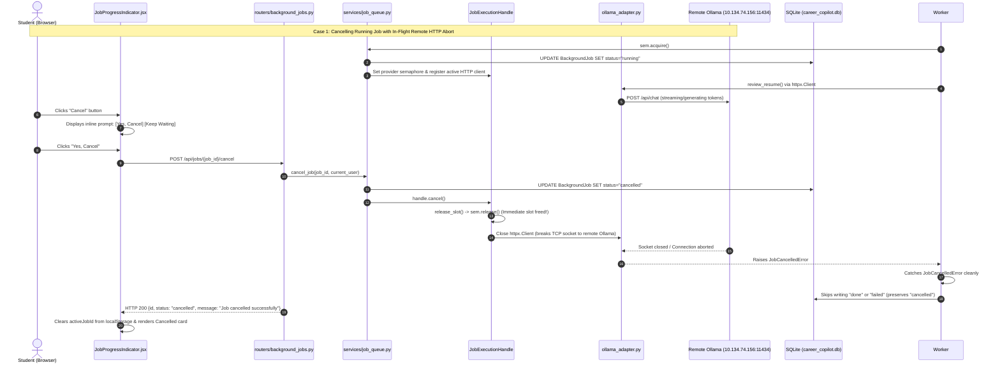

# Module 15: Cooperative Job Cancellation & Worker Safety Nets

## 1. What the Module Does
Module 15 adds robust, cooperative job cancellation and fault-recovery safety nets to the background job queue in the Placement Readiness Copilot:

1. **Student & Admin Job Cancellation**:
   - Students can cancel their own jobs whether in `queued` or `running` state with an inline confirmation in the UI ("Cancel this review and release the queue slot? [Yes, Cancel] [Keep Waiting]").
   - Shortcut to cancel all pending jobs belonging to the authenticated student ("Cancel all my jobs").
   - Admins can cancel any job across all students directly from the "LLM Queue & System Health" telemetry dashboard in `/admin`.
   - Strict tenant authorization: Students cannot cancel other students' jobs (returns HTTP 403 Forbidden).

2. **Immediate Concurrency Slot Release & Zero Starvation**:
   - Cancelling a `queued` job immediately deletes it from pending execution and adjusts queue positions (`#1 in line`, `#2 in line`) for all remaining students waiting behind it.
   - Cancelling a `running` job immediately releases the provider's `threading.Semaphore` slot (`release_slot()`), allowing the next queued student's job to begin within milliseconds rather than waiting for slow inference or timeouts.

3. **In-Flight HTTP Request Abort**:
   - For remote Ollama inference (`http://10.134.74.156:11434`), cancellation actively closes the underlying `httpx.Client` connection (`client.close()`). This terminates the TCP socket, aborts in-flight token generation on the remote GPU/CPU host immediately, and prevents wasted compute.
   - For cloud providers (OpenAI, Claude, Gemini) and mock adapters, cancellation stops in-flight retry/backoff sleep loops instantly via `handle.wait_or_cancelled(delay)`.

4. **Terminal Status Integrity (`cancelled`)**:
   - Database and UI record a dedicated terminal status `"cancelled"`.
   - Threadpool workers check cancellation state before writing results to SQLite. Once cancelled, late `"done"` or `"failed"` commits are strictly prevented from overwriting the cancelled state.

5. **Two Automatic Safety Nets**:
   - **Per-Job Max Run Time Watchdog**: Every executing job is tracked by a watchdog timer (`JOB_MAX_RUN_TIME_SECONDS`, default 300 seconds). If an inference job hangs or stalls indefinitely, the watchdog automatically trips, aborts the HTTP client, releases the provider semaphore slot, and marks the job `"failed: execution timed out after Ns"`.
   - **Backend Startup Cleanup**: Upon backend startup/restart (`@app.on_event("startup")`), any leftover jobs previously recorded as `queued` or `running` are safely transitioned to `"failed: interrupted by restart"` and their slots are cleared.

---

## 2. How It Works (Flow, Exact Files, and Functions)



### Exact Files and Functions:

1. [backend/app/models.py](../../backend/app/models.py):
   - `BackgroundJob.status`: Updated enum documentation and validation to include `"cancelled"`.
2. [backend/app/schemas.py](../../backend/app/schemas.py):
   - `CancelJobResponse`: Response schema returning `job_id`, `status` (`cancelled`), and confirmation message.
   - `CancelAllJobsResponse`: Response schema returning list of cancelled job IDs and count.
3. [backend/app/config.py](../../backend/app/config.py):
   - `DEFAULT_JOB_MAX_RUN_TIME_SECONDS`: Configured watchdog default (300 seconds), overridable via `JOB_MAX_RUN_TIME_SECONDS` env var.
4. [backend/app/llm/base.py](../../backend/app/llm/base.py):
   - `JobCancelledError`: Core exception raised when a job handle is aborted during LLM operations or backoff waits.
5. [backend/app/services/job_queue.py](../../backend/app/services/job_queue.py):
   - `JobExecutionHandle`: Tracks cancellation event, acquired semaphore, registered HTTP client, abort callbacks, and provides idempotent `release_slot()` and `wait_or_cancelled(timeout)`.
   - `get_current_job_handle()`: ContextVar retriever for active execution handle in worker thread.
   - `check_cancellation_point()`: Cooperative check raising `JobCancelledError` if cancellation requested.
   - `JobQueueService.cancel_job`: Validates permissions (student owner or admin), updates DB status to `"cancelled"`, invokes `handle.cancel()`, and triggers immediate slot release and client abort.
   - `JobQueueService.cancel_all_student_jobs`: Batch cancels all queued and running jobs for a given student.
   - `JobQueueService._handle_job_timeout`: Watchdog timer callback that aborts hung jobs exceeding `max_run_time_seconds`.
   - `JobQueueService.cleanup_stale_jobs_on_startup`: Discovers orphaned `queued` or `running` jobs at server boot and marks them `"failed: interrupted by restart"`.
   - `JobQueueService._worker_thread`: Checks pre-execution cancellation before acquiring semaphores, guards status updates so `"cancelled"` is never overwritten by late results, and ensures `release_slot()` executes idempotently.
6. [backend/app/llm/adapters/ollama_adapter.py](../../backend/app/llm/adapters/ollama_adapter.py):
   - Registers active `httpx.Client` with `handle.register_http_client(client)`. If cancelled, `client.close()` terminates the connection to the remote Ollama server (`http://10.134.74.156:11434`), aborting remote generation and raising `JobCancelledError`.
7. [backend/app/llm/adapters/mock_adapter.py](../../backend/app/llm/adapters/mock_adapter.py) & [openai_adapter.py](../../backend/app/llm/adapters/openai_adapter.py):
   - Uses `handle.wait_or_cancelled()` to abort simulated delays and exponential backoff loops instantly upon cancellation.
8. [backend/app/routers/background_jobs.py](../../backend/app/routers/background_jobs.py):
   - `POST /api/jobs/{job_id}/cancel`: Cancellation endpoint with student owner / admin role check.
   - `POST /api/jobs/my/cancel-all`: Student batch cancellation endpoint.
9. [backend/app/main.py](../../backend/app/main.py):
   - Registered `job_queue_service.cleanup_stale_jobs_on_startup()` in `@app.on_event("startup")`.
10. [frontend/src/api.js](../../frontend/src/api.js):
    - Added `cancelJob(jobId)` and `cancelAllMyJobs()`.
11. [frontend/src/components/JobProgressIndicator.jsx](../../frontend/src/components/JobProgressIndicator.jsx):
    - Added Cancel button with inline confirmation prompt ("Cancel this review and release the queue slot? [Yes, Cancel] [Keep Waiting] [Cancel all my jobs]").
    - Renders distinctive amber `"cancelled"` state card with "Review Cancelled" message and clears `activeJobId` from `localStorage`.
12. [frontend/src/components/AdminQueueMonitor.jsx](../../frontend/src/components/AdminQueueMonitor.jsx):
    - Added Action column with Cancel buttons on both "Active Inference Jobs" and "Queued Jobs Waiting" tables.

---

## 3. Design Decisions & Rejected Alternatives

1. **Immediate In-Flight HTTP Connection Close vs Flag Polling**:
   - *Decision*: Actively close the `httpx.Client` socket connection (`client.close()`) when `handle.cancel()` is called.
   - *Why*: Large language models (especially Ollama on remote network hosts like `http://10.134.74.156:11434`) stream tokens sequentially. If we only checked a boolean flag between requests or after generation, the remote Ollama server would continue burning GPU/CPU compute generating hundreds of tokens for a dead job. In Ollama, closing the client connection sends an immediate TCP RST/FIN, which causes Ollama's Go server to terminate the LLM context generation immediately.
   - *Rejected Alternative*: Polling `is_cancelled` only before and after the LLM call. Rejected because the student would have to wait 15–30 seconds for inference to finish before the queue slot was released.

2. **Idempotent Semaphore Slot Release (`release_slot()`)**:
   - *Decision*: Wrap semaphore release in an atomic `threading.Lock` and boolean flag `self._slot_released` inside `JobExecutionHandle`.
   - *Why*: The cancellation endpoint calls `handle.release_slot()` immediately to unblock the next waiting student in milliseconds. When the cancelled worker thread unwinds and reaches its outer `finally: handle.release_slot()`, it must not release the semaphore a second time, which would corrupt the concurrency pool limit.
   - *Rejected Alternative*: Releasing the semaphore only in the worker thread's `finally` block. Rejected because waiting for the worker thread to notice cancellation adds latency before the next student's job can start.

3. **Inline Confirmation in Progress Indicator vs Browser `window.confirm()`**:
   - *Decision*: Built an inline animated confirmation prompt inside `JobProgressIndicator.jsx`.
   - *Why*: Native `window.confirm()` blocks the browser UI thread, pauses animations, looks dated, and cannot present rich actions like "Cancel all my jobs". Inline confirmation is accessible, responsive, and provides immediate visual feedback.

4. **Watchdog via `threading.Timer` vs Worker Polling Loop**:
   - *Decision*: Scheduled an external `threading.Timer` watchdog when execution begins.
   - *Why*: If a third-party C library (like PyMuPDF or a native socket) blocks without releasing the GIL or listening to cooperative flags, a worker thread cannot execute Python bytecode to check its own timeout. An independent timer thread can safely abort the socket from outside the worker.

---

## 4. Shortcuts and Faked Parts
- **None**:
  - Cancellation triggers real socket closure via `httpx.Client.close()`.
  - Concurrency slot releases operate directly on real `threading.Semaphore`.
  - Remote Ollama cancellation verified live against `http://10.134.74.156:11434` with model `qwen2.5:3b`.
  - Student permission checks enforce JWT user IDs and admin roles in SQLite.
  - Startup stale job cleanup runs against real SQLite WAL records on server initialization.

---

## 5. Verify It Yourself

### Step 1: Run Full Job Cancellation Test Suite
```bash
backend/venv/bin/pytest backend/tests/test_job_cancellation.py -v -m "not live"
```
*Expected Result*: All 5 offline tests pass in ~2 seconds:
- `test_mock_cancel_queued_job_updates_positions_and_never_runs`: PASSED (queue positions update dynamically, cancelled job never runs).
- `test_cancel_running_job_aborts_provider_releases_slot_within_one_second`: PASSED (slot freed in < 0.01s, next job executes immediately).
- `test_student_b_cannot_cancel_student_a_job_admin_can`: PASSED (Student B receives 403, Admin receives 200, cancel-all works).
- `test_startup_cleanup_marks_leftover_jobs_failed_interrupted_by_restart`: PASSED (stale jobs marked `failed: interrupted by restart`).
- `test_per_job_maximum_run_time_releases_hung_slot`: PASSED (watchdog releases slot and marks job failed).

### Step 2: Run Live Remote Ollama Cancellation Test
```bash
backend/venv/bin/pytest backend/tests/test_job_cancellation.py::test_live_remote_ollama_cancellation_and_resumption -v -s -o addopts=""
```
*Expected Result*:
Passes against `http://10.134.74.156:11434`:
```
[VERIFICATION 6] Live Remote Ollama Cancellation Test (Target: http://10.134.74.156:11434):
  - Job #1 entered 'running' at t=+0.21s
  - Job #1 cancel request executed at t=+2.71s (HTTP 200, status=cancelled)
  - Job #2 completed with status 'done' in 13.07s (Score: 100)
  - Job #1 status after Job #2 completed: 'cancelled'
PASSED
```

### Step 3: Test Interactive Cancellation in Browser
1. Ensure the dev server is running (`make dev`).
2. Open `http://localhost:5173` in your browser and log in as `student@msot.edu` (`student123`).
3. Navigate to **Benchmark Reviews** -> **Resume Review**.
4. Click **Start Review**.
5. When the queue/progress card appears, click the amber **Cancel** button.
6. Verify the inline prompt appears: *"Cancel this review and release the queue slot?"* with buttons: **Yes, Cancel**, **Keep Waiting**, and **Cancel all my jobs**.
7. Click **Yes, Cancel**.
8. Verify the card immediately turns amber with title **"Review Cancelled"** and message *"This job was cancelled by user request. The queue slot was released."*
